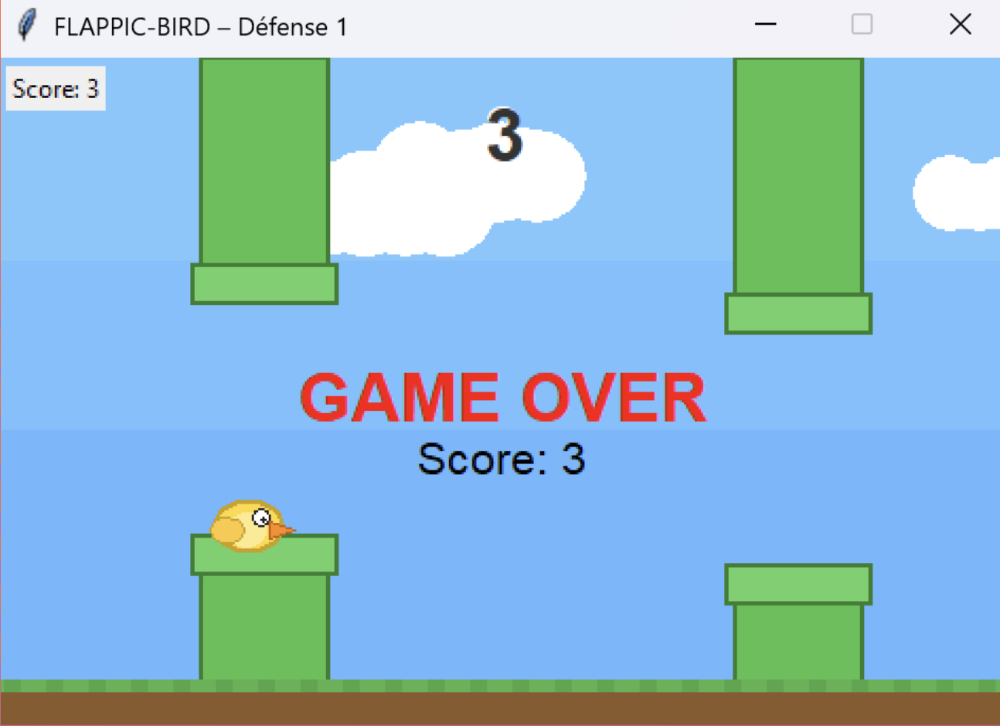
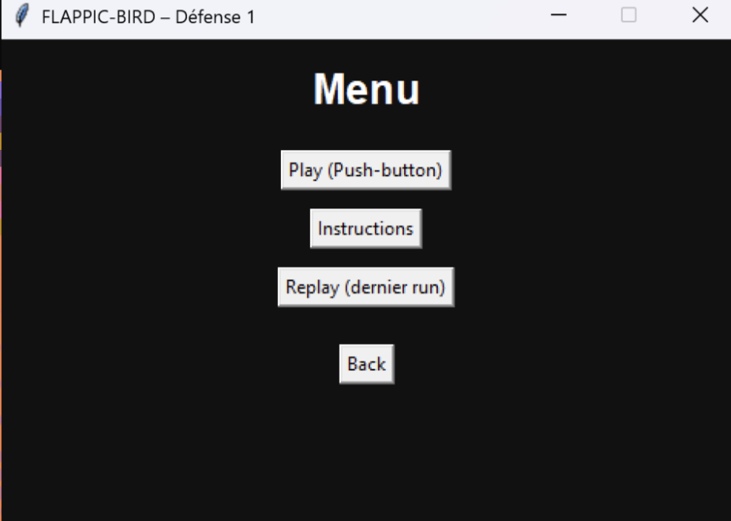
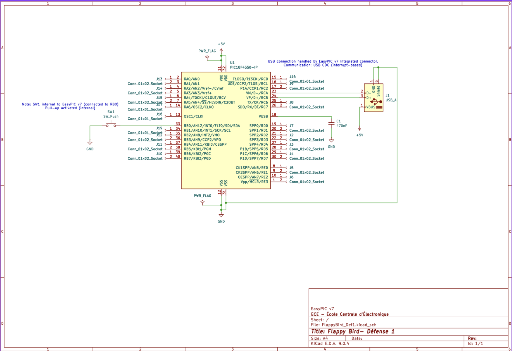

# Flappic Bird – Flappy Bird sur microcontrôleur PIC

Réimplémentation du jeu **Flappy Bird** sur une carte **EasyPIC v7** (microcontrôleur PIC18F4550), avec une interface graphique en **Python**.
Projet d'équipe réalisé en 4e année du cycle ingénieur (ING4, Systèmes Embarqués) à l'**ECE Paris**, 2025-2026.

  

## Le projet

Le microcontrôleur gère les capteurs et les entrées du joueur, puis envoie les commandes à un PC par **USB** (liaison série).
Le jeu lui-même tourne dans une interface **Python** : l'oiseau monte quand le joueur agit et retombe sous l'effet de la gravité, et chaque tuyau franchi rapporte un point.

L'objectif était aussi de **comparer plusieurs capteurs** pour contrôler l'oiseau (précision, temps de réponse).

## Fonctionnalités

- **4 modes de jeu** selon le capteur utilisé :
  - Bouton poussoir (assembleur inline)
  - Encodeur numérique (assembleur inline)
  - Capteur à ultrasons HC-SR04 (assembleur inline)
  - Capteur infrarouge IR Distance Click (C)
- Menu : Play, Instructions, Replay, avec un écran « Press Start » qui clignote à 1 Hz
- Communication USB entre la carte et le PC, gérée par interruption
- Meilleur score de chaque mode sauvegardé en **EEPROM**
- Score affiché sur les **afficheurs 7 segments**, effets sonores au **buzzer**
- Inclinaison de l'oiseau affichée sur l'écran **GLCD**
- Mode **Replay** : rejoue en accéléré la dernière partie

  

## Schéma électronique

Schéma réalisé sous **KiCad** : PIC18F4550, bouton poussoir sur RB0 (pull-up interne) et liaison USB via le connecteur de la carte EasyPIC v7.

## Technologies

- **C** et **assembleur inline**, compilateur **XC8** (MPLAB X)
- Carte **EasyPIC v7**, microcontrôleur **PIC18F4550**
- Interruptions, timers, entrées/sorties numériques, liaison **USB CDC**
- Interface graphique en **Python** (Tkinter)
- Schéma électronique sous **KiCad**

## Ma contribution

- **Interface graphique Python** : moteur de jeu (gravité, génération aléatoire des tuyaux), animation des nuages en arrière-plan et rendu graphique de l'oiseau
- **Communication USB CDC** : mise en place de la liaison entre le PIC18F4550 et le PC, la carte étant vue comme un port série virtuel
- **Menu du jeu** : écran « Press Start », choix des modes de jeu et du mode Replay
- **Modes de jeu bouton poussoir et capteur infrarouge** : acquisition des entrées en C et en assembleur inline, puis envoi des commandes au jeu
- **Mode Replay** : enregistrement des commandes de la dernière partie et relecture accélérée dans l'interface

## Équipe

Projet réalisé en équipe de 4 étudiants.
